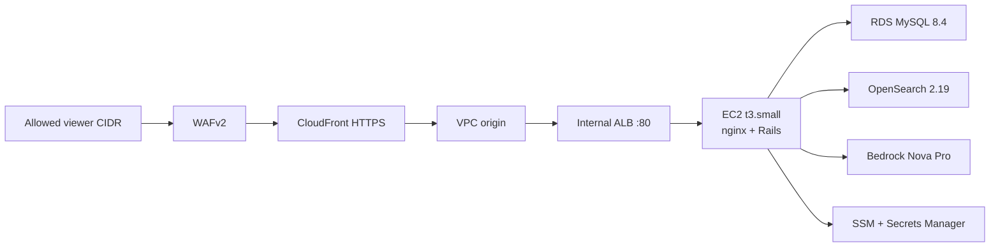

# GreatSchools Guided Search

AWS Breaking Barriers Hackathon 2026. An AI-powered school discovery app: parents describe what they need, the guide retrieves published GreatSchools evidence, then Amazon Bedrock writes the explanation.

Ruby on Rails 8 serves the UI. Amazon OpenSearch holds the school index. Amazon Bedrock (`amazon.nova-pro-v1:0`) extracts needs and writes chat text. Evidence rows — ratings, programs, “no data published” — are scored in Ruby from the school document, not by the model.

## How a turn works

1. The parent sends a message (city, grade, and needs such as gifted, arts, or busing).
2. `GuidedSearch::BedrockAgent` extracts supported needs. Search runs only when location, grade, and at least one need are present.
3. `GuidedSearch::OpenSearchRetriever` hybrid-ranks schools (BM25 + k-NN, blended 50/50 in Ruby).
4. `GuidedSearch::EvidenceScorer` marks each criterion `confirmed`, `partial`, `needs_attention`, or `missing` from published fields. A null rating is **missing**, never a low score.
5. The model writes `why`, `rank_label`, and the chat reply only.

Card shape is documented in [`docs/card_contract.md`](docs/card_contract.md). Search internals are in [`docs/search_and_data.md`](docs/search_and_data.md).

The 25-school sample in `db/seeds/school_data.json` is Florida-only. Queries that ask for unpublished offerings (STEM programs, after-school care) return no cards, because those keys must be confirmed before a school is shown.

## AWS architecture

There is no CodePipeline, API Gateway, or Lambda app tier. CDK deploys CloudFormation stack `GreatSchoolsGuidedSearch` in `us-east-1`.



| Service | Role |
| --- | --- |
| **CloudFront** | Public HTTPS front door. Caching disabled. Viewer TLS terminates here. |
| **WAFv2** | Default deny. Only `AllowedClientCidrs` reach the demo. |
| **VPC origin + internal ALB** | CloudFront talks to a private ALB. ALB ingress is the CloudFront origin-facing prefix list. Health check: `/up`. |
| **EC2** (`t3.small`, Amazon Linux 2023) | App server: nginx, Puma, Rails. Not the database or the model. |
| **RDS MySQL 8.4.8** (`t4g.micro`) | Sessions, shortlists, chat history. Private subnet, TLS required. |
| **OpenSearch 2.19** (`t3.small.search`, domain `greatschools-guided`) | `schools` and `programs` indexes. SigV4 from the instance role. |
| **Bedrock** | Nova Pro for the agent. Titan Text Embeddings V2 (1024-dim) at index time. |
| **S3** | Rails release zip (CDK asset) and optional `datasets/*`. |
| **SSM Parameter Store** | `/greatschools/guided-search/secret-key-base`, `/greatschools/guided-search/google-maps-api-key`. |
| **Secrets Manager** | Generated RDS credentials. |
| **CloudWatch Logs** | Bootstrap, Rails, and nginx (one-week retention). |

EC2 is the only browser-facing process. RDS, OpenSearch, and Bedrock are separate managed services the instance role is allowed to call.

## Local development

Ruby **3.4.8**, MySQL 8, Bundler. OpenSearch and AWS credentials are optional until you wire the real retriever.

```bash
bundle install
bin/rails db:create db:migrate
bin/rails server   # http://127.0.0.1:3000
```

Defaults: `GuidedSearch::DemoAgent` and `GuidedSearch::DemoSearch` (synthetic Woodstock cards, no AWS).

Copy [`.env.example`](.env.example) and export the vars (this app reads the environment; there is no dotenv gem).

### Real search locally

```bash
docker run --rm -p 9200:9200 \
  -e discovery.type=single-node \
  -e plugins.security.disabled=true \
  -e OPENSEARCH_INITIAL_ADMIN_PASSWORD=Dev_Only_Passw0rd! \
  opensearchproject/opensearch:2.17.1

export OPENSEARCH_URL=http://localhost:9200 EMBEDDINGS_MODE=stub
bin/rails data:reload
bin/rails opensearch:status

export GUIDED_SEARCH_AGENT=GuidedSearch::BedrockAgent
export GUIDED_SEARCH_RETRIEVER=GuidedSearch::OpenSearchRetriever
```

`EMBEDDINGS_MODE=stub` uses deterministic vectors (no Bedrock). Set `bedrock` plus AWS credentials for Titan. HTTPS `OPENSEARCH_URL` is SigV4-signed automatically.

Rake: `data:load`, `data:reload`, `opensearch:create_indexes`, `opensearch:drop_indexes`, `opensearch:recreate_indexes`, `opensearch:status`, `aws:smoke`.

### Tests and smoke

```bash
bin/rails test
OPENSEARCH_URL=http://localhost:9200 EMBEDDINGS_MODE=stub bin/rails test
bin/smoke                         # DemoSearch path against a running server
bin/smoke https://dxxxx.cloudfront.net
```

OpenSearch integration tests skip unless `OPENSEARCH_URL` is set.

## Deploy

Create the SSM parameters first, enable Bedrock access for Nova Pro and Titan Embeddings V2, then:

```bash
cd infra
npm install
npx cdk deploy \
  --parameters OriginAvailabilityZones=us-east-1a,us-east-1b \
  --parameters AllowedClientCidrs=203.0.113.10/32
```

Use two `us-east-1` AZs that support CloudFront VPC origins (not `use1-az3`; names vary by account). Pass every demo viewer as `/32`.

CDK uploads the Rails tree as an S3 asset and replaces the instance when user data changes. Bootstrap (`infra/deploy/bootstrap.sh`) installs Ruby 3.4, pulls the zip, bundles, precompiles assets, and starts systemd + nginx. `infra/deploy/with-config` loads RDS secrets and SSM keys, migrates, and execs Puma.

Stack outputs: `Url` (CloudFront), `InstanceId`, `AppLogGroup`, `SyntheticDataBucket`.

Production Rails allows `d*.cloudfront.net` only (`config.assume_ssl` because CloudFront terminates TLS). After deploy, load indexes on the instance, for example via SSM Session Manager:

```bash
sudo greatschools-run bin/rails data:reload
```

Set `EMBEDDINGS_MODE=bedrock` in production when Titan is enabled.
